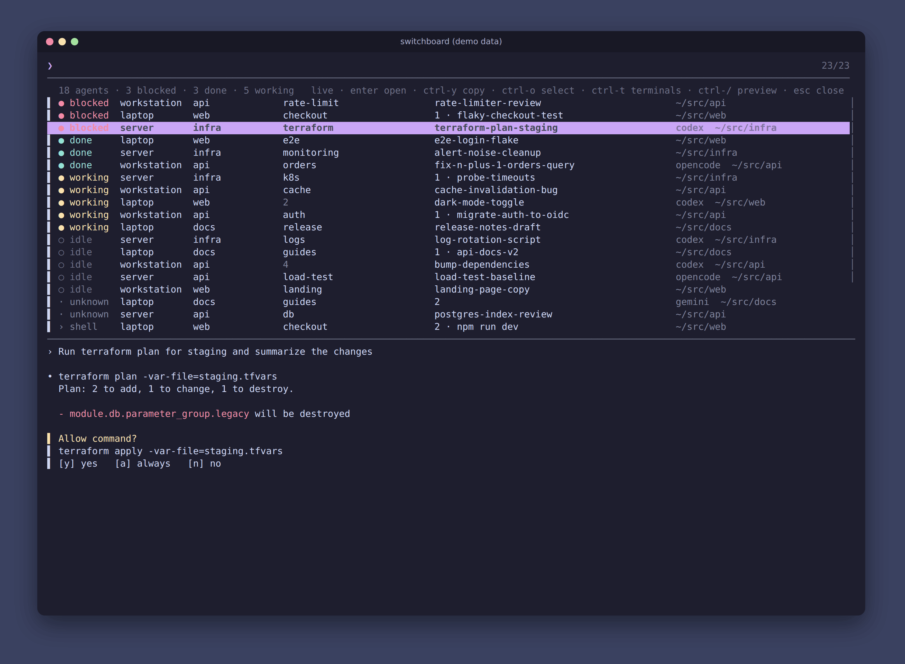

# herdr-switchboard

Every agent and terminal on every machine you've added to herdr, in one popup, sorted by what
needs you.

[](https://github.com/trustxai/herdr-switchboard/actions/workflows/ci.yml)
[](https://github.com/trustxai/herdr-switchboard/releases)
[](LICENSE)




## What it does

- **All your machines in one list.** This machine and every machine saved in herdr
  (`herdr machine add`) show up together. Nothing is installed on the other machines:
  Switchboard runs their herdr CLI over ssh.
- **Enter takes you to the pane.** On this machine it focuses it. On another machine it focuses
  it there, and with the opt-in [cross-machine jump](#jump-to-another-machine-opt-in) (macOS
  and Ghostty) your herdr window itself switches to it.
- **Sorted by what needs you:** blocked, done, working, idle, unknown, then plain terminals.
  Inside a status the most recent change goes on top, whatever machine it happened on.
- **`done` means "finished and not seen yet"**, tracked across machines, so work that finished
  while you were looking at another machine stays marked until you go there.
- **Live.** While the popup is open it reads this machine every second and each saved machine
  every 3 seconds. On the top row the cursor stays on top, where the most urgent row goes;
  further down it follows the agent you were on.
- **Preview** of the selected pane at the bottom, without the agent's input box and status bar.
- **Copy from the list:** `ctrl-y` copies the agent's last reply, `ctrl-o` opens the pane in a
  viewer where a mouse selection is copied. Both go to the clipboard of the machine
  you are typing on, even when the pane lives elsewhere.
- **Terminals too.** Shells without an agent are listed, and `ctrl-t` switches to just them.
  The interface is in English or Spanish.


## Install

```sh
herdr plugin install trustxai/herdr-switchboard
herdr plugin list                     # trustxai.switchboard should be there
```

You need:

- **herdr 0.9.5 or newer.**
- **Python 3.9 or newer** as `python3` on the herdr server's `PATH`. The `/usr/bin/python3` of
  macOS is enough; there is nothing to `pip install`.
- **fzf 0.71 or newer.** Ubuntu 24.04's apt package is 0.44, too old: install a release from
  [the fzf repository](https://github.com/junegunn/fzf/releases) or use Homebrew
  (`brew install fzf`).

If Python or fzf is missing or too old, the popup says what to install instead of opening.

**Install it on each machine you open it from.** The key runs on the herdr server of the machine
your window is showing, so if you look at your laptop and at a server through the same window,
install the plugin on both. Machines you just want to *see* in the list need nothing: to list
them, Switchboard runs the herdr that is already there.

## Bind a key

Add this to herdr's `config.toml` and reload it with `herdr server reload-config`:

```toml
[[keys.command]]
key = "prefix+space"
type = "plugin_action"
command = "trustxai.switchboard.open"
description = "switchboard"
```

To open it with `cmd+k` in Ghostty, send herdr's prefix and the key as text (this assumes the
default prefix, `ctrl+b`):

```
keybind = cmd+k=text:\x02\x20
```

## Use it

| Key | What it does |
| --- | --- |
| type | filter on any column: status, machine, workspace, tab, pane, directory |
| `enter` | go to the pane, or to a terminal's tab (on another machine, see [below](#other-machines)) |
| `ctrl-y` | copy the agent's last reply (see *Copying* below) |
| `ctrl-o` | open the pane in a viewer: drag to select, the selection is copied on release; wheel, arrows, `j`/`k` or Page Up/Down to scroll; `esc` or `q` to go back |
| `ctrl-t` | just the terminals; press again for everything |
| `ctrl-/` | hide or show the preview |
| `esc` | close |

**The order** is the one herdr's own agent panel uses with `agent_panel_sort = "priority"`:
`● blocked` (red), `● done` (cyan), `● working` (yellow), `○ idle`, `· unknown`, and plain
terminals (`› shell`) at the end, in tab-bar order. Inside a status, the agent whose change
Switchboard saw last goes on top, whatever its machine. Changes that happened while the popup
was closed are seen together when it opens, so they are interleaved: the latest of each
machine, then the next one of each. With a query, matches that score the same keep this order.

**The columns** are machine, workspace, tab and pane, as in herdr's navigator. A tab without a
name shows its number, dimmed. The pane shows its name (from `herdr pane rename` or the agent)
or else the title the agent set; in a split tab its position goes in front (`2 · npm run dev`).
The agent's kind is shown when it is not `claude`, then the working directory, dimmed.

**The header** counts agents and those blocked, done and working, then says which machines are
still loading, which are offline, and which rows come from a saved copy (`server from 40 s
ago`).

**When is something `done`?** herdr's own status is not enough across machines: a server counts
as seen whatever finishes in its active tab, even while you are looking at another machine.
So Switchboard keeps its own record. Finished work counts as seen when you open the popup on
that tab, when you pick it with Enter, when herdr had it `done` and turned it idle (you went
there some other way), or when it finished outside the active tab of its machine and is
already idle. Anything else stays `done`. A machine Switchboard has not read before starts
with everything counted as seen.

**Copying.** For a Claude Code session on this machine, `ctrl-y` takes the last reply from the
session's transcript; otherwise it reads the last reply block from the screen, or copies what
is on screen. The footer says which. Both `ctrl-y` and `ctrl-o` write OSC 52, which herdr
forwards to the terminal you type in.

## Other machines

Save a machine with `herdr machine add` and it appears in the list. For each enabled saved
machine with an ssh target, Switchboard runs `herdr` there over ssh, in batch mode and on one
shared connection per machine; if that fails, or the machine has no ssh target, it uses
`herdr --machine <id>`. If the remote shell does not find `herdr`, set `[remote] herdr` (the
default already adds the usual Homebrew directories to `PATH`).

- The last snapshot of each saved machine is kept, so its rows appear the moment the popup
  opens, marked with their age in the header, until the fresh ones arrive. A copy older than
  `cache_max_age` (30 minutes) is not shown.
- A machine that does not answer within 8 seconds (`remote_timeout`) shows as `offline` at the
  bottom; the others are not held up. A machine that stops answering while the popup is open keeps its last rows.

**What Enter does on another machine's row**, with the jump off (the default): it focuses that
pane on its machine through herdr's API, and the popup stays open with a footer, `focusing it on
server…`, then `ready on server: switch to that machine to see it`. A focus through the API
moves every window attached to that machine's server, so when you switch to it (the sidebar or
herdr's navigator), you land on that pane. The focus runs in a process of its own, so pressing
`esc` right away does not cancel it.

## Jump to another machine (opt-in)

herdr gives plugins no way to change which machine your window shows. On macOS, Ghostty accepts
keystrokes through AppleScript, so the jump types into your window what you would: herdr's
navigator, a search that matches just that pane, and Enter. It is **off by default**. To turn it
on:

```toml
[jump]
enabled = true
client = "laptop"      # the ssh target of the Mac running your herdr window, or "local"
```

It needs:

- the herdr window running in **Ghostty 1.4 or newer on macOS**;
- **non-interactive, key-based ssh from the herdr server to that Mac** (not needed with
  `client = "local"`, when the server is that Mac);
- the plugin and `python3` on the Mac too, or `[jump] helper` set to the command that runs
  this plugin's `bin/switchboard` there;
- herdr's prefix at `ctrl+b`, with `/` after it opening the navigator and `/` again its search:
  the jump types exactly `ctrl+b`, `/`, `/`, the search and Enter;
- the machine you jump to saved in the Mac's herdr under the same label as on the server: the
  helper runs `herdr --machine <label>` there.

Without `client`, Switchboard tries to find the Mac itself from the ssh connections of the
windows attached to the server (Tailscale helps name them when it is installed, but is not
required), and with several Macs it picks the one touched last. Setting `client` is safer.

**What it runs on the Mac**, over ssh: `herdr plugin list --json` to find the plugin (unless
`helper` is set), then the plugin's helper, started when the popup opens so Enter has one line
to send. The helper finds the terminal running herdr, starts `osascript` and waits; on Enter it
sends the keystrokes to that Ghostty terminal and asks herdr to focus the pane. When no search
matches just that pane, it renames the pane for a moment and restores the name. On `esc` or a
row of the local machine it exits without doing anything. The server sends the normal API
focus too, so if the keystrokes do not arrive the pane is still waiting on its machine.

**The cost:** the server must be able to log in to your Mac, and anyone who controls the account
running the herdr server can then type into your terminal. Read the jump section of
[SECURITY.md](SECURITY.md) before you turn it on.

## Configuration

`herdr plugin config-dir trustxai.switchboard` prints the directory; the file is `config.toml`
in it. Every option is optional. The ones you are most likely to change:

```toml
lang = "en"            # "en" or "es"
local_label = ""       # this machine's name in the list; empty means the short hostname

[refresh]
remote_seconds = 3     # how often each saved machine is read while the popup is open

[colors]
accent = "magenta"     # palette names follow your terminal theme; "#rrggbb" works too
selected_bg = "magenta"

[jump]
enabled = false        # see "Jump to another machine"
```

[`config.example.toml`](config.example.toml) lists every option with its default and range. A
mistake never stops the popup: a file that does not parse means all the defaults, a bad value
means that option's default, and the header says what was wrong.

## How it compares

herdr 0.9 and later already list every machine in their own navigator, and several plugins
cover parts of this. Compared on 2026-11-13 from each project's README (and herdr's source):

| | Other machines in one list | One step to a pane on another machine | Sorted by what needs you | Refreshes while open | Pane preview | Copy text | Plain terminals |
|---|---|---|---|---|---|---|---|
| herdr-switchboard¹ | Yes, nothing to install there | Opt-in (macOS + Ghostty); otherwise focuses it on its machine | Yes | Yes | Yes | Last reply, mouse selection | Yes |
| herdr's own Goto / Agents panel | Yes | Yes (Goto) | Agents panel only | Yes² | No² | No² | Goto only |
| paddock | Yes (python3 there) | Yes, inside its own view | Needs-you section on top | Yes | Last lines | Inside an opened pane | Yes |
| herdr-mirror | As mirrored workspaces in the sidebar | Yes² (the mirror pane) | No (per-host groups) | Yes | No² | Yes | Yes² |
| herdr-tower | Yes | No | No (sidebar order) | Yes | Yes | Not documented | No |
| OmniSearch | Needs the plugin on every machine | Two steps | No | No | Indexed text | IDs only | Off by default |
| herdr-radar-plus | Yes (Agents panel) | Not documented | Yes | Yes² | No | No | No |
| herdr-recap | Desktop app only | Desktop app only | Yes | Yes | Summary | Not documented | No |
| herdr-bar | Desktop-app mod only | No | Yes | Yes | Yes | Not documented | Yes |
| herdr-picker | No (attaches the whole machine) | No | Blocked first | Yes | Yes | IDs only | Yes |

¹ Checked against `bin/switchboard` 0.1.0. ² Inferred; not written in that project's README.
Corrections are welcome in an issue.

## Troubleshooting

- **The key does nothing.** Check `herdr plugin list` on the machine your window is showing (see
  [Install](#install)), the `[[keys.command]]` block, and `herdr server reload-config`.
- **It says fzf is missing or too old.** It looks on `PATH` and in the Homebrew directories.
  Distribution packages are often older than 0.71; see [Install](#install).
- **A machine shows `offline`.** From the server, try `ssh -o BatchMode=yes <target> herdr
  --version`; if it asks for a password or does not find `herdr`, fix the key or set
  `[remote] herdr`. Raise `[refresh] remote_timeout` for a slow link.
  `python3 bin/switchboard --rows`, run from the plugin's directory (`plugin_root` in
  `herdr plugin list --json`), prints the list without fzf.
- **Rows marked `from 40 s ago` stay that way.** That machine has not answered yet; it is the
  saved copy. If it never updates, see the previous point.
- **The header starts with `config …`.** The config file has a problem; the message says which,
  and the defaults are in use.
- **The jump does not happen.** Check the [requirements](#jump-to-another-machine-opt-in), set
  `[jump] client`, and try `ssh -o BatchMode=yes <client> true` from the server. macOS may ask
  once whether the process may control Ghostty.
- **The order or the `done` marks look wrong.** They live in `recency.json` in the plugin's
  state directory; deleting it starts them over.

## Demo mode and screenshots

```sh
python3 bin/switchboard --demo
```

shows the real interface over the sample data in `demo/fixtures.json`: three machines
(`laptop`, `workstation`, `server`), invented sessions, and a short timeline that changes two
of them while it is open. It needs no herdr, ssh or network, writes nothing outside temporary
directories, and Enter prints what it would have run.

The images above come from it. `docs/render.sh` regenerates both with one command: it runs the
demo in a tmux server of its own, sends the keys, captures each screen with its colours,
draws it as a terminal window in HTML (`docs/ansi2html.py`) and takes the screenshot with
headless Chrome; ImageMagick builds the GIF. It needs tmux, fzf, Chrome or Chromium and
ImageMagick, uses no network, and leaves nothing behind.

## Security

Switchboard runs the local herdr and fzf, runs herdr on your saved machines over your own ssh
(in batch mode, never prompting), or through `herdr --machine`, and opens no other network
connection. It keeps the last snapshot of each saved machine and a small record of what you
have seen in its state directory, never pane output or credentials. The jump, when you turn it on, adds
ssh from the server to your Mac. [SECURITY.md](SECURITY.md) has the details and how to report a
vulnerability privately.

## Contributing

Bug reports and pull requests are welcome; please read [CONTRIBUTING.md](CONTRIBUTING.md).
`make check` runs what CI runs. Changes are listed in [CHANGELOG.md](CHANGELOG.md).

## License

[Apache License 2.0](LICENSE). Copyright 2026 Alejandro Latorre; published under the
[TrustAI](https://github.com/trustxai) organisation.
