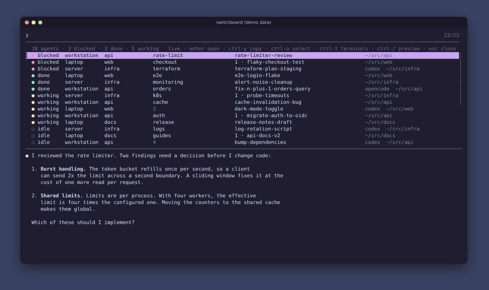

# herdr-switchboard

Every agent and terminal on every machine you've added to herdr, in one popup, sorted by what
needs you.

[](https://github.com/trustxai/herdr-switchboard/actions/workflows/ci.yml)
[](https://github.com/trustxai/herdr-switchboard/releases)
[](LICENSE)


## What it does

- **All your machines in one list.** This machine and every machine saved in herdr
  (`herdr machine add`) show up together. Nothing is installed on the other machines:
  Switchboard runs their herdr CLI over ssh.
- **Enter takes you to the pane.** On this machine it focuses it. On another machine, when your
  herdr window runs in Ghostty on macOS, the window itself switches to it (the
  [cross-machine jump](#jump-to-another-machine), on by default); otherwise it focuses the pane
  there.
- **Sorted by what needs you:** blocked, done, working, idle, unknown, then plain terminals.
  Inside a status the most recent change goes on top, whatever machine it happened on.
- **`done` means "finished and not seen yet"**, tracked across machines, so work that finished
  while you were looking at another machine stays marked until you go there.
- **Live.** While open it reads this machine every second and each saved machine every 3 s.
  The cursor follows the agent you were on, or stays on the top row if it was there.
- **Preview** of the selected pane at the bottom, without the agent's input box and status bar.
- **Copy from the list:** `ctrl-y` copies the agent's last reply, `ctrl-o` opens the pane in a
  viewer where a mouse selection is copied. Both go to the clipboard of the machine you are
  typing on, even when the pane lives elsewhere.
- **Terminals too.** Shells without an agent are listed, and `ctrl-t` switches to just them.
  The interface is in English or Spanish.



## Install

```sh
herdr plugin install trustxai/herdr-switchboard
herdr plugin list                     # trustxai.switchboard should be there
```

You need:

- **herdr 0.9.5 or newer.**
- **Python 3.9 or newer** as `python3` on the herdr server's `PATH`. The `/usr/bin/python3` of
  macOS is enough; there is nothing to `pip install`.
- **fzf 0.71 or newer.** Ubuntu 24.04's apt package is 0.44, too old: install a release from
  [the fzf repository](https://github.com/junegunn/fzf/releases) or use Homebrew
  (`brew install fzf`).

Without a `python3` on that `PATH`, the pane says so and waits for Enter. If Python is too old,
or fzf is missing or too old, the popup says what to install.

**Install it on each machine you open it from.** The key runs on the herdr server of the machine
your window is showing. Machines you just want to *see* in the list need nothing: Switchboard
runs the herdr already there. With the plugin on them too, their `done` marks follow what your
window drew there (see [Use it](#use-it)).

## Bind a key

Add this to herdr's `config.toml` and reload it with `herdr server reload-config`:

```toml
[[keys.command]]
key = "prefix+space"
type = "plugin_action"
command = "trustxai.switchboard.open"
description = "switchboard"
```

To open it with `cmd+k` in Ghostty, send herdr's prefix and the key as text (`\x02` is
`ctrl+b`, herdr's default prefix):

```
keybind = cmd+k=text:\x02\x20
```

## Use it

| Key | What it does |
| --- | --- |
| type | filter on any column: status, machine, workspace, tab, pane, directory |
| `enter` | go to the pane, or to a terminal's tab (on another machine, see [below](#other-machines)) |
| `ctrl-y` | copy the agent's last reply (see *Copying* below) |
| `ctrl-o` | the pane in a viewer: drag to select, copied on release; scroll with the wheel, arrows, `j`/`k` or Page Up/Down; `esc` or `q` to go back |
| `ctrl-t` | just the terminals; press again for everything |
| `ctrl-/` | hide or show the preview |
| `esc` | close |

**The order** is the one herdr's own agent panel uses with `agent_panel_sort = "priority"` (as
of herdr 0.9.5): blocked (red `●`), done (cyan `●`), working (yellow `●`), idle (`○`), unknown
(`·`), and plain terminals (`›`) at the end, in tab-bar order. Inside a status, the agent that
changed last goes on top, whatever its machine. Where the plugin is installed, its hook notes
when that machine saw each change, so this matches herdr's panel even for what changed while the
popup was closed. Elsewhere, what changed while it was closed interleaves machine by machine,
because herdr gives no time for a change and the counters of two machines cannot be compared.
With a query, matches that score the same keep this order.

**The columns** are machine, workspace, tab and pane, as in herdr's navigator, then the agent's
kind (when it is not `claude`) and the directory, dimmed. A pane shows its name, or else the
title its agent set; in a split tab its position goes in front (`2 · npm run dev`).

**The header** counts the agents and those blocked, done and working, and names the machines
still loading, offline, or shown from a saved copy (`server from 40 s ago`).

**When is something `done`?** herdr's own panel counts finished work as seen once the window
has drawn it, and keeps that count inside each window, where no API reaches. A server's own
status is no substitute: it counts as seen whatever finishes in its active tab, even while you
look at another machine. So on each machine the plugin notes which agents a window drew, in a
pane token (`switchboard_drawn`), and the popup reads it with the rest of that machine's state.
The notes come from `bin/drawn`, which herdr runs on the events that change what a window shows
and which keeps a small watcher reading the local state once a second: herdr sends no event
when a window starts showing another machine. Only the windows you have opened the popup from
count, so a Mac's own screen that nobody looks at does not mark anything seen.

Finished work counts as seen when one of those windows drew it after it finished, when you open
the popup on its tab, or when you pick it with Enter. Each machine's popup keeps its own record.
It can still differ from herdr's panel:

- herdr counts a window only while its terminal is in front. Switchboard cannot tell, so what
  a window draws while Ghostty is behind another app counts as seen here.
- A look at another machine shorter than about a second may not be noted.
- When two windows show the same machine at once (a Mac's own screen and the window you use),
  herdr gives its layout the size of the one that attached or resized last. What the other one
  draws is then noted under that size: work you watched there can stay `done`, and if you open
  the popup there, that size starts to count.
- On a machine without the plugin, or where nothing was drawn since its herdr server started,
  there are no notes, and Switchboard guesses from that machine's focus instead: finished work
  counts as seen when herdr turned it from `done` to idle, when that machine's focus moved off
  the tab it finished in (other than by Enter in the popup), or when it finished outside that
  machine's active tab and is already idle. Install the plugin on every machine you save in
  herdr to get the notes.

**Copying.** For a Claude Code session on this machine, `ctrl-y` takes the last reply from the
session's transcript; otherwise it reads the last reply block from the screen, or copies what
is on screen. The footer says which. Both keys write OSC 52, which herdr forwards.

## Other machines

Save a machine with `herdr machine add` and it appears in the list. For each enabled saved
machine with an ssh target, Switchboard runs `herdr` there over ssh, in batch mode and on one
shared connection per machine; if that fails, or the machine has no ssh target, it uses
`herdr --machine <id>`. If the remote shell does not find `herdr`, set `[remote] herdr` (the
default adds the Homebrew directories to `PATH`).

- The last snapshot of each saved machine is kept, so its rows appear the moment the popup
  opens, marked with their age in the header, until the fresh ones arrive. A copy older than
  `cache_max_age` (30 minutes) is not shown.
- A machine that does not answer within 8 seconds (`remote_timeout`) shows as `offline` at the
  bottom; the others are not held up. A machine that stops answering while the popup is open
  keeps its last rows.

**What Enter does on another machine's row** when the [jump](#jump-to-another-machine) does not
happen (it is off, or it found no herdr window in Ghostty on a Mac it can reach): it focuses
that pane on its machine through herdr's API, and the popup stays open with a footer,
`focusing it on server…`, then `ready on server: switch to that machine to see it`. As of herdr
0.9.5, a focus through the API moves every window attached to that server, so switching to it
(sidebar or navigator) lands on that pane. The focus runs in its own process: `esc` does not
cancel it.

## Jump to another machine

As of herdr 0.9.5, a plugin has no way to change which machine your window shows. On macOS,
Ghostty accepts keystrokes through AppleScript, so the jump types into your window what you
would: herdr's navigator, a search that matches just that pane, and Enter. It is **on by
default**. When it cannot happen, Enter focuses the pane on its machine as described above,
with no error and no wait beyond the one below.

**If your herdr `[keys] prefix` or `[keys] goto` are not herdr's defaults (`ctrl+b` and
`prefix+g`), set the same values under `[jump]`.** The jump types the prefix, the navigator key,
`/`, a search and Enter into your window, and with other bindings those keys would land in the
pane you are on. So before it types anything, the helper on the Mac checks the window it would
type into. It finds that window's herdr config from the window's own environment, as herdr
0.9.5 picks it (`HERDR_CONFIG_PATH`, else `$XDG_CONFIG_HOME/herdr/config.toml`, else
`~/.config/herdr/config.toml`; no file means herdr's defaults), reads its `[keys]` and
`[[keys.command]]` bindings, and runs `herdr config check` on it. There is no jump when:

- its `[keys] prefix` and `goto` are not `[jump]`'s (an upper-case key letter, as in `ctrl+B`, is
  shift in herdr, so it never matches; `Ctrl+b` does);
- another action, or a `[[keys.command]]` in that config, is bound to goto's key or to the prefix;
- `herdr config check` reports a parse or read error (herdr then uses every default) or says
  anything about `keys.prefix` or `keys.goto`, or herdr is not there to ask;
- the window uses the server's keys: started with `--remote-keybindings server`, or with
  `HERDR_REMOTE_KEYBINDINGS=server` in its environment;
- anything is unsure: an environment it cannot read or that has no `HOME`, a relative or missing
  path, or, on a Python without `tomllib` (the `/usr/bin/python3` of macOS is 3.9), a config it
  cannot read line by line for sure (a multi-line string, a value that spans lines, a quoted
  table name, `keys` set at the top level).

Enter then focuses the pane on its machine, and the footer adds `no jump: set [jump] prefix and
goto to this window's herdr keys`.

Two things the helper cannot see. In herdr 0.9.5 a window takes its `[[keys.command]]` bindings
from the server it is showing, not from its own config, and registers them after its own keys
and before herdr's defaults; so a command on goto's key in that server's config takes a goto you
left at herdr's default, with no diagnostic. Setting `goto` in the window's own `[keys]`, even to
the default, avoids that, since the window's own keys come first. And the helper reads the
config file as it is now: a window that has not reloaded it since it changed
(`herdr server reload-config`) may still use the old keys.

```toml
[jump]
enabled = true         # the default; false turns the jump off
client = "laptop"      # the ssh target of the Mac running your herdr window, or "local"
prefix = "ctrl+b"      # your herdr [keys] prefix; this is herdr's default
goto = "prefix+g"      # your herdr [keys] goto (the navigator); this is herdr's default
```

It needs:

- the herdr window running in **Ghostty 1.4 or newer on macOS**;
- **non-interactive, key-based ssh from the herdr server to that Mac** (not needed with
  `client = "local"`, when the server is that Mac);
- the plugin and `python3` on the Mac too, the same version as on the server, or `[jump]
  helper` set to the command that runs this plugin's `bin/switchboard` there. A helper of an
  older version never says it is ready: Enter then focuses the pane instead, after waiting for
  it at most 2 seconds, and only until the popup gives up on it, 8 seconds after starting it;
- the machine you jump to saved in the Mac's herdr under the same label as on the server: the
  helper runs `herdr --machine <label>` there;
- **`prefix` and `goto` matching the window's herdr config.** The jump types the prefix, the
  navigator key, `/` (which focuses the navigator's search), the search and Enter; with other
  bindings those keys would land in your pane, so the helper checks them first (above) and does
  not jump when they differ. Each value must be in the small set that
  [`config.example.toml`](config.example.toml) lists. One that is not turns the jump off for
  that run: the header says `bad value for jump.goto, so the jump is off` (or `jump.prefix`),
  and Enter works as with `enabled = false`.

Without `client`, Switchboard looks for the Mac among the ssh connections of the windows
attached to the server (Tailscale, if installed, helps name them) and picks the one touched
last. Setting `client` is safer.

**What it runs on the Mac**, over ssh: `herdr plugin list --json` to find the plugin (unless
`helper` is set), then the plugin's helper, started with the popup so Enter has one line to
send. The helper looks for a herdr window whose terminal is Ghostty's (with several, the one you
typed into last; when it cannot tell, none), and checks that window's herdr keys (above);
without such a window, or with keys it cannot confirm, it exits at once, and Enter focuses the pane
instead. Otherwise it says it is ready, and only then does Enter jump. If you press Enter while
that connection is still being set up, it waits for it at most 2 seconds; a Mac that does not
answer, or a helper that says nothing within 8 seconds of starting, never holds the popup
longer than that, and once the popup has given up on it, Enter focuses the pane at once. On Enter the
helper checks what it would type (keys, search, terminal) before anything else, and if one
falls outside its character set it renames and types nothing. Otherwise it sends the
keystrokes to the Ghostty terminal running herdr and asks herdr to focus the pane; when no
search matches just that pane, it renames the pane for a moment. On `esc` it exits doing
nothing. The server sends the normal API focus too, so the pane is ready on its machine even if
the keystrokes do not arrive.

**The cost:** when the herdr server can log in to your Mac with a key, the jump uses that login,
and anyone who controls the account running the herdr server can then type into your terminal.
Read the jump section of [SECURITY.md](SECURITY.md). To turn the jump off, set `enabled = false`
under `[jump]`; the server then never connects back to your Mac for it.

## Configuration

`herdr plugin config-dir trustxai.switchboard` prints the directory; the file is `config.toml`
in it. Every option is optional. The ones you are most likely to change:

```toml
lang = "en"            # "en" or "es"
local_label = ""       # this machine's name in the list; empty means the short hostname

[refresh]
remote_seconds = 3     # how often each saved machine is read while the popup is open
local_timeout = 5      # seconds to wait for this machine's herdr; raise it if it is slow

[colors]
accent = "magenta"     # palette names follow your terminal theme; "#rrggbb" works too

[jump]
enabled = true         # the default; see "Jump to another machine" for client, prefix and goto
prefix = "ctrl+b"      # must match your herdr [keys] prefix
goto = "prefix+g"      # must match your herdr [keys] goto
```

[`config.example.toml`](config.example.toml) lists every option with its default and range. A
mistake never stops the popup: the header says what it did instead (see
[Troubleshooting](#troubleshooting)).

## How it compares

herdr 0.9 and later already list every machine in their own navigator, and several plugins
cover parts of this. Compared on 2026-11-13 from each project's README (and herdr's source):

| | Other machines in one list | One step to a pane on another machine | Sorted by what needs you | Refreshes while open | Pane preview | Copy text | Plain terminals |
|---|---|---|---|---|---|---|---|
| herdr-switchboard¹ | Yes, nothing to install there | Yes with macOS + Ghostty; otherwise focuses it on its machine | Yes | Yes | Yes | Last reply, mouse selection | Yes |
| herdr's own Goto / Agents panel | Yes | Yes (Goto) | Agents panel only | Yes² | No² | No² | Goto only |
| paddock | Yes (python3 there) | Yes, inside its own view | Needs-you section on top | Yes | Last lines | Inside an opened pane | Yes |
| herdr-mirror | As mirrored workspaces in the sidebar | Yes² (the mirror pane) | No (per-host groups) | Yes | No² | Yes | Yes² |
| herdr-tower | Yes | No | No (sidebar order) | Yes | Yes | Not documented | No |
| OmniSearch | Needs the plugin on every machine | Two steps | No | No | Indexed text | IDs only | Off by default |
| herdr-radar-plus | Yes (Agents panel) | Not documented | Yes | Yes² | No | No | No |
| herdr-recap | Desktop app only | Desktop app only | Yes | Yes | Summary | Not documented | No |
| herdr-bar | Desktop-app mod only | No | Yes | Yes | Yes | Not documented | Yes |
| herdr-picker | No (attaches the whole machine) | No | Blocked first | Yes | Yes | IDs only | Yes |

¹ Checked against `bin/switchboard` 0.1.0, where the jump was off by default; it is on since.
² Inferred; not written in that project's README.

## Troubleshooting

- **The key does nothing.** Check `herdr plugin list` on the machine your window is showing (see
  [Install](#install)), the `[[keys.command]]` block, and `herdr server reload-config`.
- **It says there is no `python3` on the PATH the herdr server runs with.** herdr's server started
  without it: install Python 3.9 or newer or add its directory to that `PATH`, then restart the
  server, as the message says.
- **It says fzf is missing or too old.** It looks on `PATH` and in the Homebrew directories.
  Distribution packages are often older than 0.71; see [Install](#install).
- **It says herdr did not answer `api snapshot` in time.** This machine's herdr was slower than
  `[refresh] local_timeout` (5 s by default). Raise it, up to 120, in the file the message names.
- **A machine shows `offline`.** From the server, try `ssh -o BatchMode=yes <target> herdr
  --version`; if it asks for a password or does not find `herdr`, fix the key or set
  `[remote] herdr`. Raise `[refresh] remote_timeout` for a slow link. `bin/switchboard --rows`
  (in the plugin's directory) prints the list without fzf.
- **The header keeps saying `server from 40 s ago`.** Those rows are the saved copy: that
  machine has not answered yet. If it never does, see the previous point.
- **The header starts with `config <path>:`.** Each problem says what happened: `unknown option X
  (ignored)`, `bad value for X (default used)`, `[X] must be a table (defaults used)`, or `bad
  value for jump.goto, so the jump is off` (copy the binding from your herdr `[keys]`, within the
  set `config.example.toml` lists). A file that cannot be read or parsed ends `(defaults in use)`.
- **Enter on another machine shows `focusing it on …` instead of jumping.** With `no jump: set
  [jump] prefix and goto …` after it, your herdr keys on that Mac differ from `[jump]`: copy them
  from its herdr `[keys]`. Without it, the jump did not find a herdr window in Ghostty on a Mac it
  can reach. Check the
  [requirements](#jump-to-another-machine), set `[jump] client`, and try
  `ssh -o BatchMode=yes <client> true` from the server. macOS may ask for Automation permission
  before it lets the helper control Ghostty.
- **Enter typed something like `g/w1:p3` into a pane.** Your herdr `[keys] prefix` or `goto`
  differ from `[jump] prefix` and `goto`, and the helper did not see it (for example, herdr reads
  its config from somewhere else on that Mac). Copy them from your herdr config into `[jump]`, or
  set `[jump] enabled = false`.
- **The order or the `done` marks look wrong.** They live in `recency.json` in the plugin's
  state directory; deleting it starts them over. If work you saw on another machine stays
  `done`, check that the plugin is installed there and that its watcher runs: in that
  machine's plugin state directory, `watch-<id>.lock` holds its process id and `drawn-<id>.err`
  its last error (one pair per herdr server).

## Demo mode and screenshots

`python3 bin/switchboard --demo` shows the real interface over the invented machines and
sessions in `demo/fixtures.json`. It needs no herdr, ssh or network, writes nothing outside
temporary directories, and Enter prints what it would run. The demo never jumps between
machines.

The images above come from it: `docs/render.sh` runs the demo in a tmux server of its own,
captures each screen with its colours, draws it as a terminal window (`docs/ansi2html.py`) and
screenshots it with headless Chrome; ImageMagick builds the GIF. It needs tmux, fzf, Chrome or
Chromium and ImageMagick, uses no network, and leaves nothing behind.

## Security

Switchboard reaches your saved machines through your own ssh (in batch mode) or
`herdr --machine`, and opens no other connection. It stores each saved machine's last snapshot
and what you have seen, never pane output or credentials. The jump, on by default, tries ssh from
the server each time the popup opens, when windows are attached to it from other machines, in
batch mode: `herdr plugin list --json` and the helper on a Mac that Tailscale names or that
`[jump] client` sets, or, without Tailscale, `uname -s` to the address of each attached window.
`[jump] enabled = false` turns it off. [SECURITY.md](SECURITY.md) has the details and how to report a vulnerability.

## Contributing

Bug reports and pull requests are welcome; please read [CONTRIBUTING.md](CONTRIBUTING.md).
`make check` runs what CI runs. Changes are listed in [CHANGELOG.md](CHANGELOG.md).

## License

[Apache License 2.0](LICENSE). Copyright 2026 Alejandro Latorre; published under the
[TrustAI](https://github.com/trustxai) organisation.
